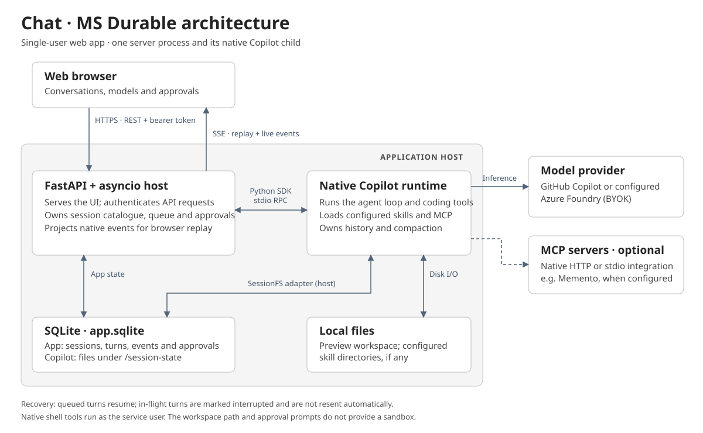

# MS Durable

MS Durable is a small asyncio/FastAPI host for the Microsoft Copilot SDK, with a SQLite session store and a browser chat interface.

**This is not an official Microsoft project.** I built it partly as tech demo for the Microsoft Copilot SDK and partly because I needed a reusable `pi-durable`-like service and starter chat app for other projects.


Copilot owns inference, coding tools, the agent loop, `AGENTS.md`, skills, MCP, compaction and transcript recovery. 

My `asyncio` shell adds a session catalogue, a durable input queue, permission decisions, event projection and a SQLite-backed native session filesystem that serves as an _approximation_ to Pi's durable storage. Since the current Copilot SDK runs as an external process, transactional guarantees are... weak, but good enough to play around with and prototype.
## Run from source

Requires Python 3.11+, Bun and Linux. Installation uses the pinned [requirements.lock](requirements.lock) and Bun lockfile. The development install includes Azure Identity for Entra authentication, because one of the uses I have for this is to talk directly to Microsoft Foundry using system managed identities.

```sh
make install
make check
make run
```

Open `http://127.0.0.1:8015`. Enter the token from `data/web-token`, or set `MS_DURABLE_TOKEN` before starting the server. The token is not printed or put in a URL for, well, obvious reasons, and the UI keeps it in browser session storage because that is the laziest thing I could do.

By default the server reads the existing Pi GitHub Copilot login from `~/.pi/agent/auth.json`, because, well, again, it was a lazy take on getting this going.`COP ILOT_GITHUB_TOKEN` takes precedence if set, and you can configure BYOK providers (again, deploying this on Azure and pointing it at Foundry will let you use managed identities and do away with all the key management shenanigans).

This is also designed to use one process and one uvicorn worker per data directory, because that's what you find in most container environments. Since I know humans and agents get creative (especially wheh running tests), an advisory file lock rejects another application server using the same directory. 

Do not restart the server from one of its own active tools. It won't like it.

| Environment variable | Default / purpose |
| --- | --- |
| `MS_DURABLE_DATA` | `./data`; persistent database, web token and native runtime state |
| `MS_DURABLE_CWD` | Current directory; native coding workspace |
| `MS_DURABLE_HOST` | `127.0.0.1`; use a deliberate bind address for remote access |
| `MS_DURABLE_PORT` | `8015` |
| `MS_DURABLE_TOKEN` | Optional server-owned web bearer token |
| `MS_DURABLE_AUTH_FILE` | `~/.pi/agent/auth.json`; read-only credential source |
| `MS_DURABLE_PROVIDERS_FILE` | Optional server-owned BYOK JSON file |
| `MS_DURABLE_MCP_FILE` | Optional server-owned MCP JSON file |
| `MS_DURABLE_SKILLS` | OS-path-separated native skill directories |
| `MS_DURABLE_AGENTS` | OS-path-separated directories for native Copilot custom agents |
| `MS_DURABLE_TLS_KEY`, `MS_DURABLE_TLS_CERT` | Optional uvicorn TLS files |

This uses SSE for transport, and I recommend HTTPS for remote access, either directly or through a reverse proxy which forwards streaming responses without buffering .The application does not manage certificates or install a service (again, designed to run in Azure PaaS or with an App Gateway in front).

## Browser and application tools

I may have gone a bit overboard for a baseline shell.

The UI has independent conversations, streaming text, expandable tool activity, a durable queue, approvals, cancellation, a model cker and native context/compaction controls. Model changes apply at a turn boundary. The UI renders messages with bundled Markdown-it, with raw HTML disabled. On reconnect it reconciles the snapshot and resumes SSE from its last sequence number.

- **Appearance:** follow the system theme or choose light or dark in Settings.
- **Commands:** type `/` in the composer for shortcuts to New chat, Plan, Context, Rename and Settings.
- **Images:** attach PNG, JPEG, GIF, WebP or SVG (up to three per message, 1 MiB each). The original bytes live in SQLite and an authenticated media route serves them. The browser displays SVG in image context. Images are not added automatically to model requests. The model can inspect them on demand with the attachment tool.
- **Tool output:** activity rows show a plain-language summary. Expand a tool call for pretty-printed JSON or plain text in **Readable**. Switch to **Raw** to inspect the recorded arguments, result and error. The paginated session event log is under **Settings → Diagnostics**.
- **Plan:** open the checklist from the chat header. It docks to the right of chat on desktop and stacks above it on narrow screens. The agent’s changes appear live; each conversation keeps its own plan in SQLite.
- **Message references:** use the **Copy** icon for text. Select the **Reference** icon or the timestamp to insert a reference into the composer. The composer and transcript show a short turn ID, such as `#e1b4c29a` (seven ID characters plus `a` for answer or `u` for user). Stored references retain the full chat ID, turn ID and role. Select the reference to jump to the message in the same chat. Answers written before timestamp support have no recorded completion time.
- **Named sessions:** use the pencil in the header to rename a session and update its `@name` without changing its ID. When Luna is available, the dialog summarises up to 20 recent settled turns. Enter an optional unique `@name` before the first send. Names are case-insensitive.
- **Multiplayer**: Agents can send to named sessions or raw session IDs using a `chat` tool. The sender’s timeline shows the message and its destination. The receiving timeline shows the message with the sender’s name. An agent can use `reply_chat` to post its result back to the original sender. The reply appears in both timelines and queues one turn for the original sender. That turn can act on the result but cannot send another chat request or reply. This is for those of you who like having sub-agents or just burn up tokens.

Application tools are visible to every application session:

- `list_sessions`, `observe_session`: session inspection, attachment metadata and a bounded timeline page. Pass `next_after` as `after_seq` for the next page. To search older history, call `observe_session` with `query` (for example `backup checksum`) and optionally `session_id` or `limit`. SQLite FTS5 returns ranked excerpts with turn IDs and event sequence numbers. All search words must match. Prompts, final answers, errors and non-streaming event text are searchable; streaming fragments and attachment bytes are excluded. Existing timelines are indexed on first startup.
- `plan`: read (`read`), replace (`update`) or atomically edit (`patch`) the current conversation’s plan. Patches use 1-based indices and support `add`, `update` and `remove`. At most one item can be `in_progress`.
- `read_attachment`: inspect a stored attachment by chat ID (or `@handle`), turn ID and ordinal. The SDK returns raster images as image results and SVG as bounded source text.
- `attach_file`: share a workspace file on the current turn without an approval prompt. Each turn can share up to five files, with a combined limit of 256 MiB. A single file can use the full limit. PNG, JPEG, GIF and WebP can appear inline when they are at most 1 MiB, 4096 pixels per side and 8 megapixels. The app copies files into SQLite in chunks. The authenticated `/media/shared/` route streams downloads, supports single HTTP byte ranges, and does not load the complete file into memory. Allow space for both the stored copy and SQLite's WAL during ingestion.
- `create_session`, `chat`: independent sessions and deduplicated one-hop delivery. An agent handling an incoming request can use `reply_chat` once to respond to its sender; it cannot start another `chat` request from that turn.
- `list_models`, `set_model`: model discovery and selection.
- `context`, `compact`: native context inspection and queued compaction.

These tools refer only to this application's database. A stable `request_id` deduplicates a submitted prompt or compaction request; reusing it with different content fails.

Native permission requests are shown in the UI. Read requests are approved once automatically. Other requests wait for an explicit approval or denial. Approve for this session remembers a matching request in that chat until the server restarts. Settings can disable prompts globally; that setting persists. Copilot can execute commands it classifies as safe without issuing a host permission request; for example, a plain `printf` did not require approval in the browser test. This is not an “approve every shell command” policy.

An agent can use `set_session_description` to update its own short description. Descriptions appear in `list_sessions` and in the sidebar tooltip. Users can also edit them in **Rename session**. Use up to 280 characters; leave the field empty to clear it.

### Delegation

Use Copilot’s native subagents for work that does not need another session’s history. Point `MS_DURABLE_AGENTS` at trusted directories containing Copilot `.agent.md` definitions to add native specialists. The SDK manages their execution.

To reuse a named session’s history, open **Rename session** on the target and enable **Allow other agents to delegate tasks to this session**. In a user-started turn, `delegate_to_sessions` accepts `tasks: [{session_id, prompt}, …]` and a `request_id`. It runs up to four distinct idle targets concurrently and returns their final answers in input order to the caller’s current turn. No `reply_chat` is needed. Use a new request ID per batch; retry the same tasks with the same ID. Normal tool approvals still apply.

The default wait is 120 seconds (`timeout_seconds`: 1–600). Busy, disabled, failed and timed-out targets are reported individually. On timeout or cancellation, queued work is cancelled; work that already started can finish in its own timeline. Delegated turns cannot use app `chat`, `reply_chat` or `delegate_to_sessions`. Queued delegations are not replayed after a restart.

## Azure Foundry / Azure OpenAI

Use the SDK's native BYOK connection. There is no separate inference HTTP client in this application. [examples/providers.json](examples/providers.json) maps a selection ID to an Azure deployment:

```sh
export MS_DURABLE_PROVIDERS_FILE=/secure/path/providers.json
export AZURE_OPENAI_API_KEY=... # supply through your secret manager
make run
```

The sample appears as `foundry/chat` in the model picker. `wire_model` is the deployment sent to Azure; `model_id` identifies the base model for Copilot behaviour and capabilities. Set token limits and capability overrides to match the deployed model. Model selection persists as the provider-qualified ID, not as credentials.

For native Azure routing:

- `type: "azure"`, with no `azure.api_version`, uses the versionless `/openai/v1/` route.
- With `azure.api_version`, the runtime uses the deployment-scoped Azure route and the `api-version` query parameter.
- `wire_api` selects native `completions` or `responses` transport. The synthetic routing tests cover **chat completions**; the live Azure Responses route has not been tested.

Supply the model inference endpoint, not an Azure AI Projects `/api/projects/...` endpoint or an Agent Service endpoint. An OpenAI-compatible Foundry endpoint can instead use native `type: "openai"` with its full API base URL; that endpoint family has not been live-tested here.

Authentication options in a provider profile:

| Field | Behaviour |
| --- | --- |
| `api_key_env` | Read an API key from the server environment |
| `bearer_token_env` | Read a static bearer token from the server environment |
| `auth: "entra"` | Use async `DefaultAzureCredential` through the native per-request bearer-token callback |
| `scope` | Optional Entra scope; defaults to `https://cognitiveservices.azure.com/.default` |

Entra uses the normal Azure Identity credential chain, including configured service-principal, managed-identity or Azure CLI credentials. The callback obtains a token for each native request; Azure Identity handles token caching. Static bearer tokens do not refresh automatically. Environment-variable names, profiles and endpoints are server configuration, not browser input.
## MCP and skills

The MCP file accepts `mcpServers` or `servers`. HTTP bearer credentials can reference a server environment variable:

```json
{
  "mcpServers": {
    "memento": {
      "url": "https://your-memento-server/mcp",
      "auth": "bearer",
      "bearerTokenEnv": "MEMENTO_TOKEN",
      "tools": ["*"]
    }
  }
}
```

The URL is illustrative. Use your existing Memento endpoint and credential. A missing bearer environment variable fails configuration. Native HTTP and stdio MCP definitions are forwarded to Copilot. For stdio, configure a command, arguments and any required child environment explicitly; JSON string values are not shell-expanded.

Set `MS_DURABLE_SKILLS` to directories containing `name/SKILL.md`. Skills and `AGENTS.md` are loaded by the native runtime. Broad configuration discovery and repository hooks are disabled; explicitly configured skills and MCP remain enabled.

## Persistence and failure handling

`data/app.sqlite` contains the catalogue, input queue, projected events, approvals and native `/session-state` files. SQLite uses WAL and full synchronous writes. Native transcript writes and application turn transitions are separate transactions, even though they share a database.

On restart, running inputs become `interrupted`, pending approvals expire and queued inputs resume. Native resume disables pending-work continuation and automatic transcript recovery. Interrupted inputs are **not** automatically resent. A process failure between a native side effect and a database update is ambiguous; persisted history does not provide exactly-once external effects.

Cancellation stops the local worker, cancels queued inputs and requests native abort where a session is attached. An in-flight session creation can finish registering a blank session, but its cancelled worker cannot send a prompt. A failed event projection stops native execution and quarantines the session until recovery. Do not resend an interrupted turn without checking its transcript and external effects.

Back up the state directory after a graceful shutdown, or use SQLite's online backup API. Do not copy only the live main database while omitting its WAL. Keep credentials, database backups and runtime files private; native transcripts and tool outputs can contain sensitive workspace content.

## Compaction and prompt-prefix caching

Automatic infinite-session compaction is enabled through the native SDK. Manual compaction is a durable queued operation using `session.rpc.history.compact`; it does not race an active user turn. Native context measurement and attribution are exposed without a second token estimator.

Copilot normally adds a changing checkpoint list to its system prompt after compaction. A targeted SDK section transform replaces only `<session_context>` with a stable pointer to `/session-state/checkpoints/index.md` and `/session-state/files/`. Other native prompt sections, guardrails, checkpoint files and conversation summaries are preserved.

Synthetic endpoint tests compare actual outbound system messages and tool definitions before and after ordinary turns, reopen and compaction. Unchanged turns retain the preceding message prefix; compaction deliberately replaces the conversation suffix. Provider/model changes, instructions, skills, MCP definitions, SDK versions or elapsed cache expiry can still invalidate caching. These tests do not prove an Azure cache hit or a billing reduction.

## Security boundaries

All authenticated browser clients share the same catalogue and can inspect or manage all application sessions. This is a single-user application, not a multi-tenant service.

The native filesystem adapter limits ordinary filesystem requests to the workspace, configured skills and SQLite session state. It rejects configured credential/state paths and destructive operations on their ancestors. Known provider, MCP and web credentials are redacted from host-projected events, errors and application-tool results. Credentials are not included in the model catalogue. The spawned native runtime receives a reduced environment and a private HOME directory.

**Neither permissions nor the filesystem adapter is a sandbox.** Native shell tools run as the server user and can access anything that user can access. Path checks do not protect against a hostile process racing symlinks. Use a dedicated OS account or an isolated container/VM with restricted mounts and network access before running untrusted prompts, repositories, skills or MCP tools. Redaction is not a substitute for that isolation.

In short, don't give gasoline and matches to this thing. It's a reusable module for me to build upon, not an enterprise-grade thing. Yet.

## Verification
The [Fluent web design plan](docs/fluent-web-plan.md) records the visual rules, implementation order and browser acceptance checks.

```sh
make check           # lint and offline tests
make test-native     # actual Copilot executable + local synthetic Azure server
make test-ui         # Chromium against a fixture API; no model calls
make test-browser    # Chromium + actual Copilot model; consumes model allowance
```

`make test-ui` covers rendering, approvals, the context dialog and the mobile drawer in light and dark schemes; screenshots are written to the run directory. Both browser targets require an installed Playwright Chromium build at `PLAYWRIGHT_BROWSERS_PATH`; `make test-browser` also needs a working Copilot credential. Set `MS_DURABLE_MODEL` to choose its model. Native tests use no real provider key or remote model. SDK installation/runtime extraction can require downloads.

Opt-in skill/Memento and restart probes use an isolated directory:

```sh
MS_DURABLE_PROBE_DIR="$WORKSPACE_TMP_BASE/ms-durable/runs/probe" \
  MS_DURABLE_MCP_FILE=/secure/path/mcp.json make live-probe
MS_DURABLE_PROBE_DIR="$WORKSPACE_TMP_BASE/ms-durable/runs/probe" \
  MS_DURABLE_MCP_FILE=/secure/path/mcp.json make live-resume
```

Set `WORKSPACE_TMP_BASE` first. Disposable paths follow its explicit override, CI temporary paths, writable `/workspace/tmp`, or a system-temp fallback, always under `ms-durable/`. The Makefile redirects pip, Python bytecode, Ruff, Bun and Copilot extraction caches. Persistent state never belongs there. See [AGENTS.md](AGENTS.md) for the workspace setup.

## Licence

[MIT](LICENSE).
